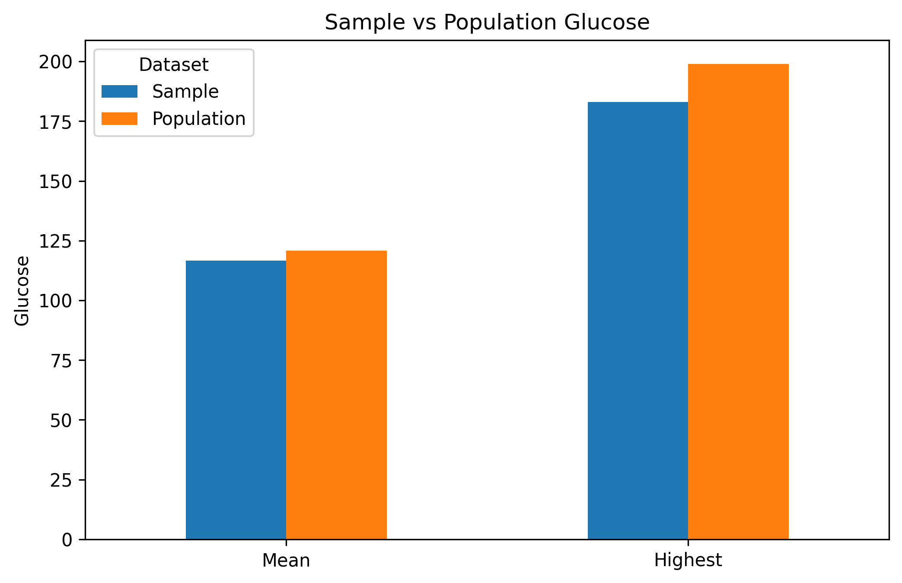
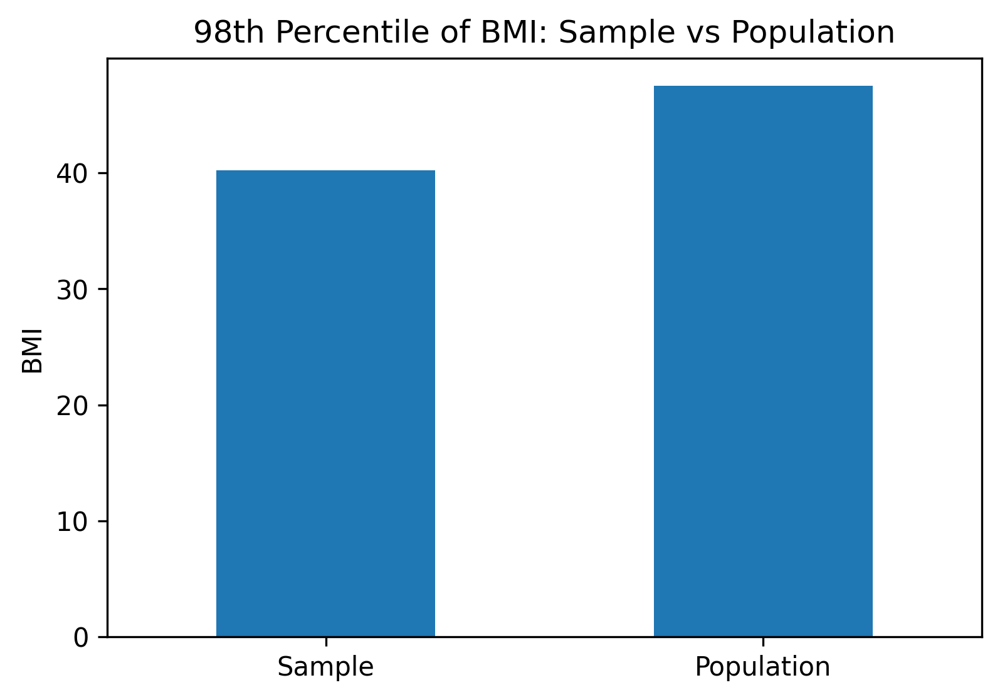
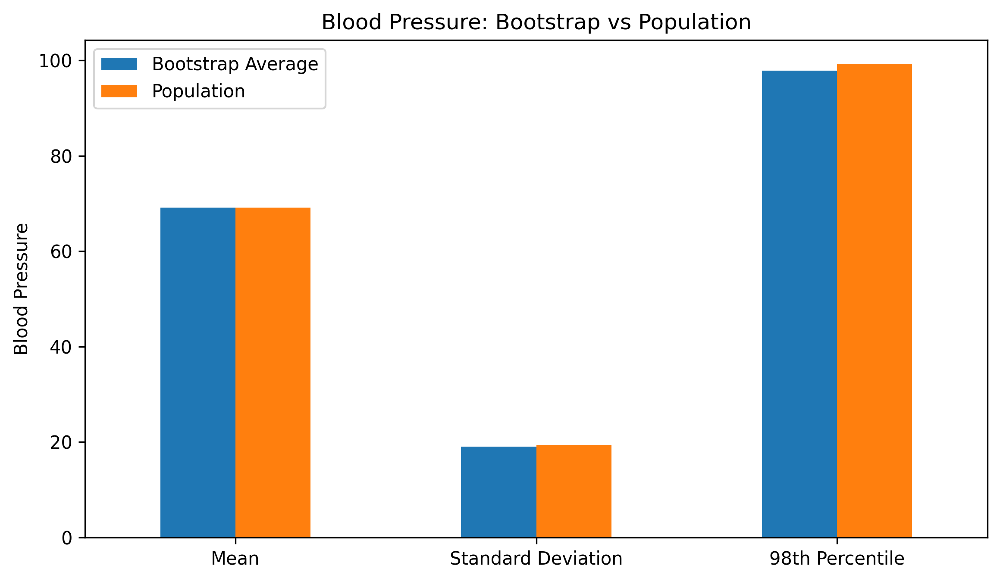

# Findings

## Q2

### A. Glucose

| Glucose         | Sample | Population |
| --------------- | ------ | ---------- |
| Mean            | 116.64 | 120.89     |
| Maximum         | 183    | 199        |

The sample mean was 116.64, while the population mean was 120.89. The sample maximum was 120.89, compared to the population maximum of 199. Overall, both the sample mean and maximum are relatively close to their corresponding population values. The largest difference is between the sample and population maximums, which makes sense because a sample of only 25 observations may not include the population's highest value.

### B. BMI

| BMI                    | Sample | Population |
| ---------------------- | ------ | ---------- |
| 98th Percentile of BMI | 40.25  | 47.53      |

The sample and population 98th percentiles are also relatively close. The sample's 98th percentile was 40.25, while the population's was 47.53. However, the difference is slightly larger, likely due to the smaller sample size of 25.

### C. Bootstraping on Blood Pressure

| BloodPressure           | Bootstrap Average | Population |
| ----------------------- | ----------------- | ---------- |
| Mean                    | 69.18             | 69.11      |
| Standard Deviation      | 19.07             | 19.36      |
| 98th Percentile         | 97.90             | 99.32      |

The bootstrap averages were very close to the population statistics. The average bootstrap mean was 69.18 compared to the population mean of 69.11. The standard deviation and 98th percentile were also close to their population values. Overall, the 500 bootstrap samples of 150 observations each produced results that were very close to the population statistics.
